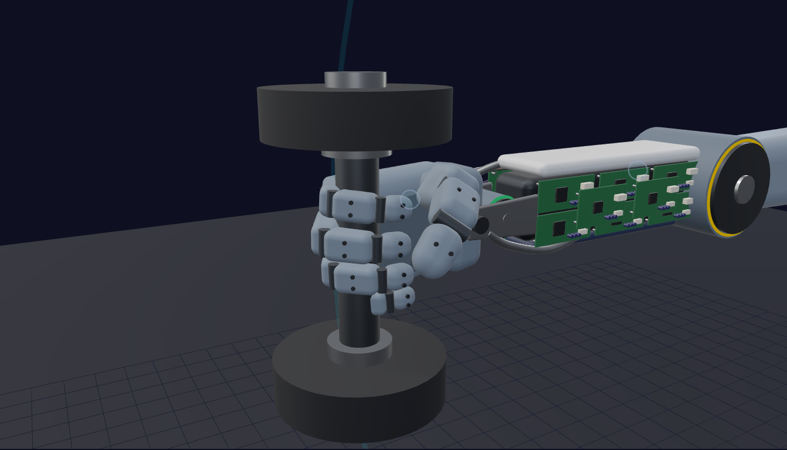
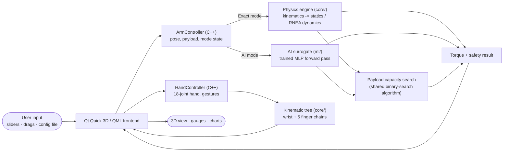
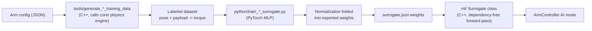

# Humanoid Arm Load Analyzer

**An interactive physics + AI tool for answering one question instantly: can this humanoid arm hold this weight, in this pose, without overloading a joint?**

Built from scratch in C++ (kinematics, statics, full rigid-body dynamics), with a PyTorch-trained neural-network surrogate for the same torque computation, and a real-time Qt Quick 3D interface showing a realistic humanoid arm — shoulder, elbow and wrist actuators, an electronics-packed forearm, and a five-finger dexterous hand — where every joint, limb and payload parameter is a live control.


---

## Why this exists

Every joint of a humanoid robot's arm is driven by an actuator with a hard torque limit. Exceed it anywhere in the chain and the joint stalls, strains, or fails — and an arm held out straight with a bag in its hand is exactly where that happens first. Designers answer "how much can this arm carry, and where" once, at design time, for one set of limb lengths and masses. It can't answer "what if the forearm were longer," "what if the hand were heavier," or "what if the elbow were bent instead," because each of those needs the dynamics re-derived by hand.

This project removes that barrier: the arm's own geometry, mass, and payload are all editable live, and every "what if" is answered the instant it's asked — by dragging a slider, not by opening a textbook.

## What makes it interesting

- **A real physics engine, not a wrapper.** Forward/inverse kinematics (Denavit-Hartenberg + joint-limited damped least-squares IK), Jacobian-transpose statics, and a full Recursive Newton-Euler dynamics derivation (gravity/inertia/Coriolis, individually decomposed and verified to sum exactly back to the total) — all written from first principles in C++ with Eigen.
- **A humanoid, not a crane.** Human proportions (0.30 m upper arm, 0.27 m forearm), human-like joint travel (an elbow that can't bend backwards, enforced everywhere including IK), and an 18-joint, five-finger hand modeled as a kinematic *tree* — every finger hangs off the wrist, the thumb sits on its own opposable base.
- **An AI surrogate that's measured, not just claimed.** A small PyTorch-trained MLP approximates the same torque function and runs through a dependency-free, hand-written C++ forward pass. Every payload scan reports real, measured timing for both paths side by side.
- **A realistic 3D model generated from the kinematics.** Every phalanx shell, hinge pin and limb housing is placed from forward kinematics — change a finger length in the config and the hand re-renders correctly. The rounded molded shells and the forearm's cables are procedural meshes (`RoundedBoxGeometry`, `TubeGeometry`) written in C++ against `QQuick3DGeometry`.
- **The hand grips what it carries.** Switch the payload to *Gripping* and the fingers close into a power grip around a dumbbell sized to the weight; release it and the hand opens. Actuator status rings glow green/amber/red with each joint's load.

## See it in action

|                                                                                                                                         |                                                                                                                                     |
| --------------------------------------------------------------------------------------------------------------------------------------- | ----------------------------------------------------------------------------------------------------------------------------------- |
|  The five-finger hand: molded shells, hinge gaps, screw-hole details, exposed control boards in the forearm. |  Holding the payload: a power grip around the dumbbell handle, thumb wrapped over the fingers.       |
|  Arm held straight out with a heavy dumbbell — the shoulder trips into OVERLOAD.                          |  A payload-capacity scan from fully extended to folded, exact engine vs. AI surrogate.    |

## Architecture

The application is split into three independent pieces that only ever share data through plain primitive types — never an internal C++ or ML-framework object crossing a boundary directly. That separation is what makes the Exact/AI comparison meaningful: both engines are called through the exact same interface, so switching between them (or benchmarking them) is a pure substitution.



| Layer                | Path            | Responsibility                                                                                                                                                                         |
| -------------------- | --------------- | -------------------------------------------------------------------------------------------------------------------------------------------------------------------------------------- |
| Physics engine       | [`core/`](core) | C++17 + Eigen. Kinematics (serial arm + branching kinematic tree), statics, full RNEA dynamics, joint-limited IK, payload capacity search, hand gestures. No UI or ML dependency.       |
| AI surrogate         | [`ml/`](ml)     | A trained MLP, plus a small hand-written, dependency-free C++ inference class. A drop-in alternative torque evaluator trained on the physics engine's own output.                      |
| Interactive frontend | [`app/`](app)   | Qt Quick 3D / QML. `ArmController` and `HandController` expose only plain Qt types to QML; `app/geometry/` holds the procedural meshes the humanoid is built from.                    |

### The humanoid model

| File                                                   | What it defines                                                                                                                                                           |
| ------------------------------------------------------ | ------------------------------------------------------------------------------------------------------------------------------------------------------------------------- |
| [`config/humanoid_arm.json`](config/humanoid_arm.json)   | Shoulder / elbow / wrist: DH geometry, link masses, actuator torque limits, named joints with travel limits (`min_deg`/`max_deg`).                                         |
| [`config/humanoid_hand.json`](config/humanoid_hand.json) | A wrist chain (roll + deviation) and five finger chains. Each chain's `origin` (`xyz` + `rpy_deg`, URDF-style) places its base in the palm — something pure DH can't express for an off-axis thumb. |
| [`app/qml/HumanoidArm3D.qml`](app/qml/HumanoidArm3D.qml) | Actuators, limb shells, forearm chassis with stacked control boards, cable bundles that bend with the wrist, the wrist clevis.                                              |
| [`app/qml/Hand3D.qml`](app/qml/Hand3D.qml)               | Palm shell, phalanges, hinge pins, fingertip pads, thumb base, and the held dumbbell — all placed from `HandController`'s forward kinematics.                              |

The arm moves in a vertical plane (gravity in-plane), so the statics and dynamics stay the well-tested planar formulation; the hand rides on the wrist in a neutral, thumb-up grip, and the grip point is the arm's end effector.

### How the AI surrogate is trained

Training labels are generated by calling the exact physics engine directly from C++ — never re-derived in Python — so the network is always learning this project's own physics, not a second, possibly-inconsistent implementation of it. Poses are sampled only inside each joint's configured travel.



## Tech stack

- **C++17**, **Eigen** (linear algebra), **nlohmann/json** (config I/O), **GoogleTest** (via CMake `FetchContent`)
- **Qt 6 / Qt Quick 3D / QML** for the real-time interactive interface (custom `QQuick3DGeometry` meshes, image-based lighting)
- **PyTorch** (training) + a hand-written C++ inference class (runtime) for the AI surrogate
- **CMake** build system

## Building and running

Requires Qt 6.5+ (Quick 3D + Quick Dialogs 2), Eigen3, and nlohmann-json on your system.

```bash
cmake -B build -DCMAKE_PREFIX_PATH=/path/to/Qt  # e.g. /usr/local/Qt-6.10.0
cmake --build build
./build/bin/robotarm_app
```

Useful flags (all optional — mainly for reproducible screenshots):

```bash
./build/bin/robotarm_app --pose -35,80,-10 --payload 6        # shoulder,elbow,wrist degrees; kg in hand
./build/bin/robotarm_app --open-hand --camera 0,0,0.45 --focus 0.3,0.3,0
./build/bin/robotarm_app --scan 40 --screenshot shot.png      # run a payload scan, save a PNG, quit
```

### Running the tests

```bash
ctest --test-dir build
```

GoogleTest suites cover every physics module (kinematics, kinematic trees with chain origins, statics, dynamics, trajectories, joint-limited inverse kinematics, payload capacity, the AI surrogates, config parsing) plus the Qt-facing `ArmController` / `HandController` layer. Generic engine tests run against small fixtures in [`tests/fixtures/`](tests/fixtures).

### Retraining the AI surrogate (optional)

```bash
python3 -m venv python/.venv && source python/.venv/bin/activate
pip install -r python/requirements.txt
./build/bin/generate_training_data config/humanoid_arm.json python/data/humanoid_arm_train.csv 30000 1 0 -9.81 0 40
./build/bin/generate_training_data config/humanoid_arm.json python/data/humanoid_arm_val.csv 3000 2 0 -9.81 0 40
python3 python/train_surrogate.py --arm-name humanoid_arm --num-joints 3 --hidden-dim 32
```

(`train_dynamic_surrogate.py` works the same way with `generate_dynamic_training_data` — see its docstring.)

## Project structure

```
core/       physics engine - kinematics, kinematic tree, statics, RNEA dynamics, IK, payload capacity, hand gestures
ml/         AI surrogate - C++ inference class + trained humanoid-arm weights
app/        Qt Quick 3D / QML interface, Arm/HandController bridges, procedural geometry (app/geometry/)
config/     humanoid_arm.json, humanoid_hand.json
tools/      C++ training-data generators (reuse the exact physics engine), studio lighting generator
python/     PyTorch training scripts
tests/      GoogleTest suite + engine test fixtures
archive/    the project's earlier industrial 3-DOF arm (configs, weights, screenshots) - unused by the app
```

## License

Released under the [MIT License](LICENSE).
