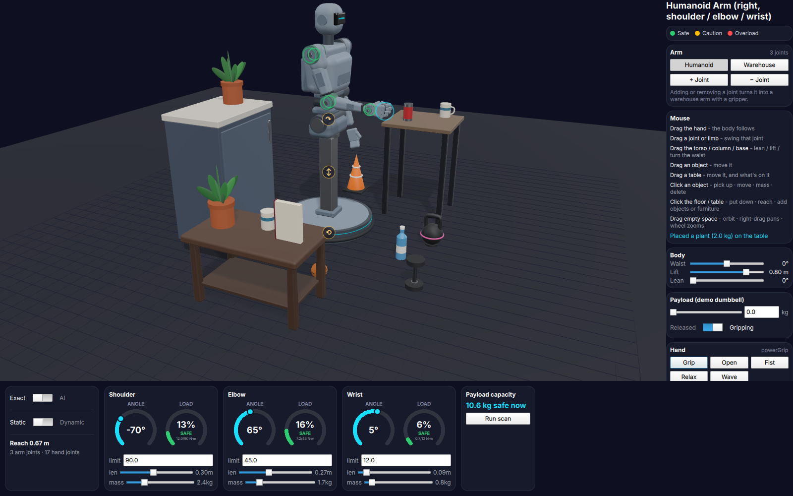
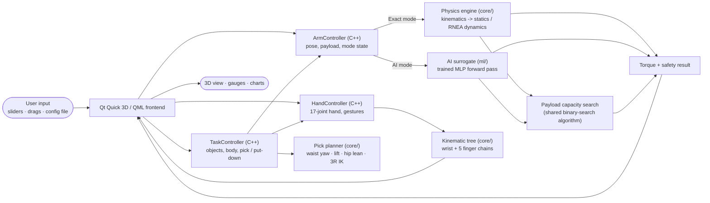
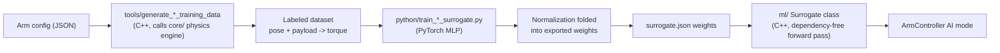

# Humanoid Arm Load Analyzer

**An interactive physics + AI tool for answering one question instantly: can this humanoid arm hold this weight, in this pose, without overloading a joint — and can the robot actually go pick it up?**

Built from scratch in C++ (kinematics, statics, full rigid-body dynamics), with a PyTorch-trained neural-network surrogate for the same torque computation, and a real-time Qt Quick 3D interface showing a humanoid on a mobile lift base — waist, lift and hip joints, a shoulder / elbow / wrist arm and a five-finger hand — that picks up the objects you put on the floor or the table, while every joint's load is analyzed live.


---

## Why this exists

Every joint of a humanoid robot's arm is driven by an actuator with a hard torque limit. Exceed it anywhere in the chain and the joint stalls, strains, or fails — and an arm held out straight with a bag in its hand is exactly where that happens first. Designers answer "how much can this arm carry, and where" once, at design time, for one set of limb lengths and masses. It can't answer "what if the forearm were longer," "what if the hand were heavier," or "what if the elbow were bent instead," because each of those needs the dynamics re-derived by hand.

This project removes that barrier: the arm's own geometry, mass, and payload are all editable live, and every "what if" is answered the instant it's asked — by dragging a slider, not by opening a textbook.

## What makes it interesting

- **A real physics engine, not a wrapper.** Forward/inverse kinematics (Denavit-Hartenberg + joint-limited damped least-squares IK), Jacobian-transpose statics, and a full Recursive Newton-Euler dynamics derivation (gravity/inertia/Coriolis, individually decomposed and verified to sum exactly back to the total) — all written from first principles in C++ with Eigen.
- **A humanoid, not a crane.** Human proportions (0.30 m upper arm, 0.27 m forearm), human-like joint travel (an elbow that can't bend backwards, enforced everywhere including IK), and a 17-joint, five-finger hand modeled as a kinematic *tree* — every finger hangs off the wrist, the thumb sits on its own opposable base.
- **An AI surrogate that's measured, not just claimed.** A small PyTorch-trained MLP approximates the same torque function and runs through a dependency-free, hand-written C++ forward pass. Every payload scan reports real, measured timing for both paths side by side.
- **A detailed 3D model generated from the kinematics.** Every phalanx shell, hinge pin and limb housing is placed from forward kinematics — change a finger length in the config and the hand re-renders correctly. The molded shells, seal bands, rings and objects are procedural meshes (`RoundedBoxGeometry`, `TubeGeometry`) written in C++ against `QQuick3DGeometry`.
- **Driven with the mouse.** Grab the hand and drag it anywhere: the waist turns, the lift rises or sinks and the torso leans so the hand follows the cursor. A whole-body reach planner picks the goal pose (a few milliseconds per mouse move) and the body *moves* there at speeds its joints could manage, every part finishing together, so even a reach far beyond the arm is a visible turn-crouch-lean, never a jump. Grab a joint or a limb to swing just that joint; grab the torso, the column or the round base to lean, lift or turn the waist yourself. Drag objects and tables around; click an object for *pick up · move · mass · delete*, click the floor or a table for *put down here · reach here · add an object or furniture*.
- **Pick and place, planned with the physics.** Put a bottle, can, mug, box, book, ball, traffic cone, potted plant, dumbbell or kettlebell (its color band follows its weight) on the floor, a table, a low coffee table or a kitchen-height counter - add and move as many of those as you like - and ask the robot to pick it up. A closed-form planner turns the waist toward it, lowers the lift and leans at the hip as needed, solves the arm's inverse kinematics *with the hand's orientation* (upright objects stay upright), and picks the pose that loads the joints least — or refuses with the reason ("too heavy - Shoulder would need 112 N·m (limit 90)"). While it's held, the object's mass is the arm's payload, so the gauges show what the robot is really carrying.
- **The body moves without breaking the physics.** Turning about the vertical axis and lifting are pure rigid motions that don't change gravity torques; leaning at the hip tilts the arm *within its own plane*, which for a planar arm is exactly a shift of the shoulder angle — so the analyzer just turns gravity in the arm's frame and every number stays exact.
- **The hand grips what it carries.** Each object size gets its own finger closure; the demo dumbbell in the Payload card gets a power grip.
- **Load you can see.** Actuator housings and status rings glow green/amber/red with each joint's load, and the limb a struggling joint drives washes amber or red.
- **Or make it a warehouse arm.** Add or remove a joint (or press *Warehouse*) and the right arm becomes an industrial arm with any number of servo joints and a parallel two-finger gripper; it picks from above when it can, from the side otherwise. *Humanoid* brings the human arm and hand back.

## See it in action

|                                                                                                                                         |                                                                                                                                     |
| --------------------------------------------------------------------------------------------------------------------------------------- | ----------------------------------------------------------------------------------------------------------------------------------- |
|  Pick and place: crouch and lean to reach a bottle on the floor, carry it, lean over the table, set it down upright. |  The five-finger hand carrying the bottle: molded shells, hinge gaps, screw heads, fingertip pads and nail plates. |
|  Arm held straight out with a heavy dumbbell — every joint trips into OVERLOAD.                                                  |  A payload-capacity scan from fully extended to folded, exact engine vs. AI surrogate.                   |
|  Dragging the hand down to the ball: the waist turns, the lift lowers and the torso leans to follow. |  The five-joint warehouse arm holding a can it picked from above with its gripper. |
|  A counter, a coffee table and the table, with plants, mugs, a book, a cone and a kettlebell; amber handles on the hip, column and base. | |

## Architecture

The application is split into three independent pieces that only ever share data through plain primitive types — never an internal C++ or ML-framework object crossing a boundary directly. That separation is what makes the Exact/AI comparison meaningful: both engines are called through the exact same interface, so switching between them (or benchmarking them) is a pure substitution.



| Layer                | Path            | Responsibility                                                                                                                                                                         |
| -------------------- | --------------- | -------------------------------------------------------------------------------------------------------------------------------------------------------------------------------------- |
| Physics engine       | [`core/`](core) | C++17 + Eigen. Kinematics (serial arm + branching kinematic tree), statics, full RNEA dynamics, joint-limited IK, payload capacity search, hand gestures, grasp planning. No UI or ML dependency. |
| AI surrogate         | [`ml/`](ml)     | A trained MLP, plus a small hand-written, dependency-free C++ inference class. A drop-in alternative torque evaluator trained on the physics engine's own output.                      |
| Interactive frontend | [`app/`](app)   | Qt Quick 3D / QML. `ArmController`, `HandController` and `TaskController` expose only plain Qt types to QML; `app/geometry/` holds the procedural meshes the humanoid is built from.  |

### The humanoid model

| File                                                   | What it defines                                                                                                                                                           |
| ------------------------------------------------------ | ------------------------------------------------------------------------------------------------------------------------------------------------------------------------- |
| [`config/humanoid_arm.json`](config/humanoid_arm.json)   | Shoulder / elbow / wrist: DH geometry, link masses, actuator torque limits, named joints with travel limits (`min_deg`/`max_deg`).                                         |
| [`config/humanoid_hand.json`](config/humanoid_hand.json) | A wrist chain (roll + deviation) and five finger chains. Each chain's `origin` (`xyz` + `rpy_deg`, URDF-style) places its base in the palm — something pure DH can't express for an off-axis thumb. |
| [`core/.../pick_planner.hpp`](core/include/robotarm/pick_planner.hpp) | Grasp planning: waist yaw that puts the object beside the palm, closed-form planar 3R IK with hand orientation (numeric IK for any other joint count), a sweep over lift height x hip lean, torque-aware choice; `plan_reach` for dragging the hand (the smallest whole-body change that gets there). |
| [`app/task_controller.hpp`](app/task_controller.hpp)     | Objects on the floor/table, the body's own joints, animated pick-up / put-down sequences that drive the arm, the hand and the payload.                                     |
| [`app/qml/HumanoidBody3D.qml`](app/qml/HumanoidBody3D.qml) | Pelvis and hip joint, segmented abdomen, chest, head, a passive left arm, and the right arm's mount.                                                                     |
| [`app/qml/HumanoidArm3D.qml`](app/qml/HumanoidArm3D.qml) | Actuators with status rings, deltoid cap, tapered limb shells, seal bands, service panels, the wrist housing.                                                             |
| [`app/qml/IndustrialArm3D.qml`](app/qml/IndustrialArm3D.qml) | The warehouse arm: a servo drum with a load band per joint, box links, tool flange and a parallel gripper. |
| [`app/qml/ArmView3D.qml`](app/qml/ArmView3D.qml), [`ObjectMenu.qml`](app/qml/ObjectMenu.qml), [`SpotMenu.qml`](app/qml/SpotMenu.qml) | The scene and all mouse handling: what a press grabbed (hand, joint, limb, object, nothing) and the click menus. |
| [`app/qml/Hand3D.qml`](app/qml/Hand3D.qml)               | Palm shell, phalanges, hinge pins, fingertip pads, thumb base, and whatever the hand is holding — all placed from `HandController`'s forward kinematics.                  |
| [`app/qml/LiftBase3D.qml`](app/qml/LiftBase3D.qml), [`SceneObject3D.qml`](app/qml/SceneObject3D.qml), [`Table3D.qml`](app/qml/Table3D.qml) | The mobile base with its telescoping column; the pickable objects; tables, coffee tables and counters. |

The arm moves in a vertical plane (gravity in-plane), so the statics and dynamics stay the well-tested planar formulation; the body places that plane in the world (waist yaw, lift height, hip lean), the hand rides on the wrist in a neutral, thumb-up grip, and the grip point is the arm's end effector.

### How the AI surrogate is trained

Training labels are generated by calling the exact physics engine directly from C++ — never re-derived in Python — so the network is always learning this project's own physics, not a second, possibly-inconsistent implementation of it. Poses are sampled only inside each joint's configured travel.



## Tech stack

- **C++17**, **Eigen** (linear algebra), **nlohmann/json** (config I/O), **GoogleTest** (via CMake `FetchContent`)
- **Qt 6 / Qt Quick 3D / QML** for the real-time interactive interface (custom `QQuick3DGeometry` meshes, image-based lighting)
- **PyTorch** (training) + a hand-written C++ inference class (runtime) for the AI surrogate
- **CMake** build system

### How C++ meets QML

The C++ side is two QML modules built with `qt_add_qml_module`, so QML imports real types instead of names injected at runtime:

| Module | Types | Used in QML as |
| --- | --- | --- |
| `Humanoid.Backend` (library `robotarm_app_core`) | `ArmController`, `HandController`, `TaskController` - `QML_ELEMENT` + `QML_SINGLETON` | `ArmController.jointCount`, `TaskController.pickUp(id)`, `Connections { target: TaskController; function onTablesChanged() {} }` |
| `Humanoid.Geometry` (the executable) | `RoundedBoxGeometry`, `TubeGeometry` - `QML_ELEMENT` | `Model { geometry: RoundedBoxGeometry { size: ... } }` |

- **Properties** (`Q_PROPERTY` with `NOTIFY`) are what QML binds to; **signals** can be handled in QML with `Connections`.
- **Actions** (`addJoint`, `pickUp`, `reachTo`, `playGesture`, ...) are `public slots`: callable from QML like functions, and connectable from C++. Read-only queries that return a value stay `Q_INVOKABLE`.
- **One shared instance.** The controllers need their config files and each other, so `main()` builds them and registers each with `setQmlInstance()`; the singleton's static `create()` hands QML that instance (`app/qml_singleton.hpp`).
- **Hot reload.** Only C++ types are in the modules; the UI's `.qml` files are loaded from `app/qml` on disk, and `QmlHotReloader` reloads the window when one is saved. The C++ state (pose, objects, tables) survives a reload.
- **Editor support.** The build writes the modules' type info to `build/qml/`. For QML completion and diagnostics in an editor through `qmlls`, run it with `-b build` (or set `buildDir` in a `.qmlls.ini`) so it finds `Humanoid.Backend` and `Humanoid.Geometry`.

## Building and running

Requires Qt 6.5+ (Quick 3D + Quick Dialogs 2), Eigen3, and nlohmann-json on your system.

```bash
cmake -B build -DCMAKE_PREFIX_PATH=/path/to/Qt  # e.g. /usr/local/Qt-6.10.0
cmake --build build
./build/bin/robotarm_app
```

Useful flags (all optional — mainly for reproducible screenshots):

```bash
./build/bin/robotarm_app --pose -35,80,-10 --payload 6        # shoulder,elbow,wrist degrees; kg in hand
./build/bin/robotarm_app --camera 40,-12,0.9 --focus 0.3,0.95,0.15
./build/bin/robotarm_app --pick 1 --put 0.6,-0.62 --at 9        # scripted pick + put-down, stopped 9 s in
./build/bin/robotarm_app --industrial 5 --pick 3                # start as a 5-joint warehouse arm, pick the can
./build/bin/robotarm_app --table "counter,-0.55,0.45" --add "plant,-0.55,0.30" --add "kettlebell,0.75,-0.05"
./build/bin/robotarm_app --scan 40 --screenshot shot.png      # run a payload scan, save a PNG, quit
```

### Running the tests

```bash
ctest --test-dir build
```

GoogleTest suites cover every physics module (kinematics, kinematic trees with chain origins, statics, dynamics, trajectories, joint-limited inverse kinematics, payload capacity, grasp planning, the AI surrogates, config parsing) plus the Qt-facing `ArmController` / `HandController` / `TaskController` layer, including whole pick-and-place sequences stepped in simulated time. Generic engine tests run against small fixtures in [`tests/fixtures/`](tests/fixtures).

### Retraining the AI surrogate (optional)

```bash
python3 -m venv python/.venv && source python/.venv/bin/activate
pip install -r python/requirements.txt
./build/bin/generate_training_data config/humanoid_arm.json python/data/humanoid_arm_train.csv 30000 1 0 -9.81 0 40
./build/bin/generate_training_data config/humanoid_arm.json python/data/humanoid_arm_val.csv 3000 2 0 -9.81 0 40
python3 python/train_surrogate.py --arm-name humanoid_arm --num-joints 3 --hidden-dim 32
```

(`train_dynamic_surrogate.py` works the same way with `generate_dynamic_training_data` — see its docstring.)

## Project structure

```
core/       physics engine - kinematics, kinematic tree, statics, RNEA dynamics, IK, payload capacity, hand gestures, pick planner
ml/         AI surrogate - C++ inference class + trained humanoid-arm weights
app/        Qt Quick 3D / QML interface, Arm/Hand/TaskController bridges, procedural geometry (app/geometry/)
config/     humanoid_arm.json, humanoid_hand.json
tools/      C++ training-data generators (reuse the exact physics engine), studio lighting generator
python/     PyTorch training scripts
tests/      GoogleTest suite + engine test fixtures
archive/    the project's earlier industrial 3-DOF arm (configs, weights, screenshots) - unused by the app
```

## License

Released under the [MIT License](LICENSE).
