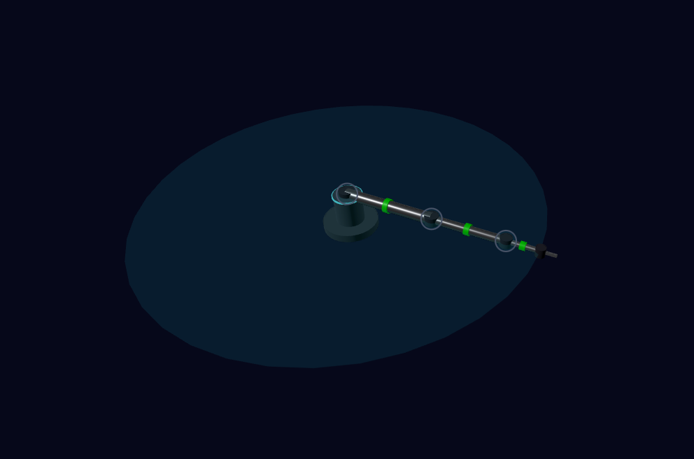
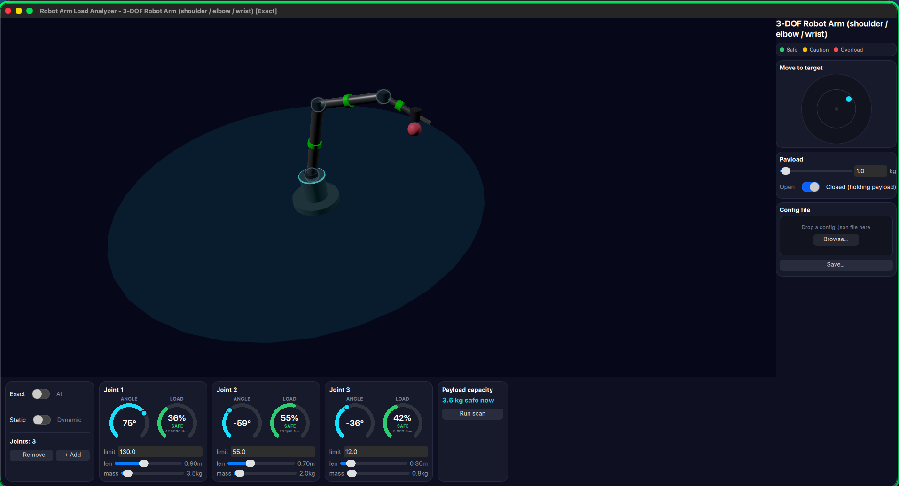
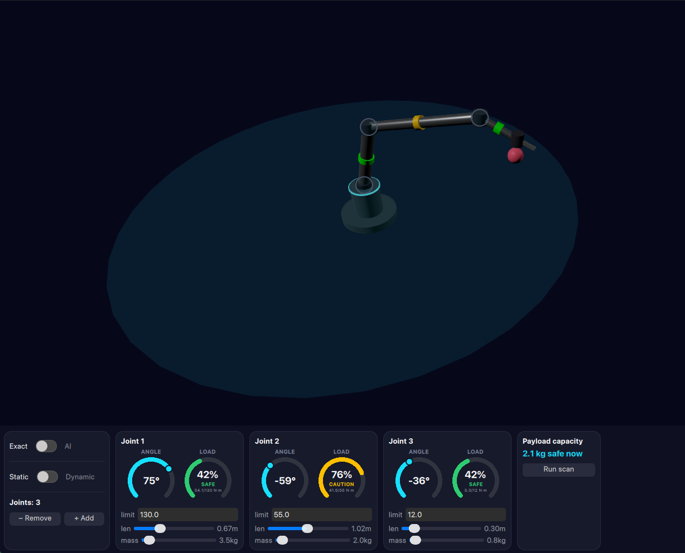
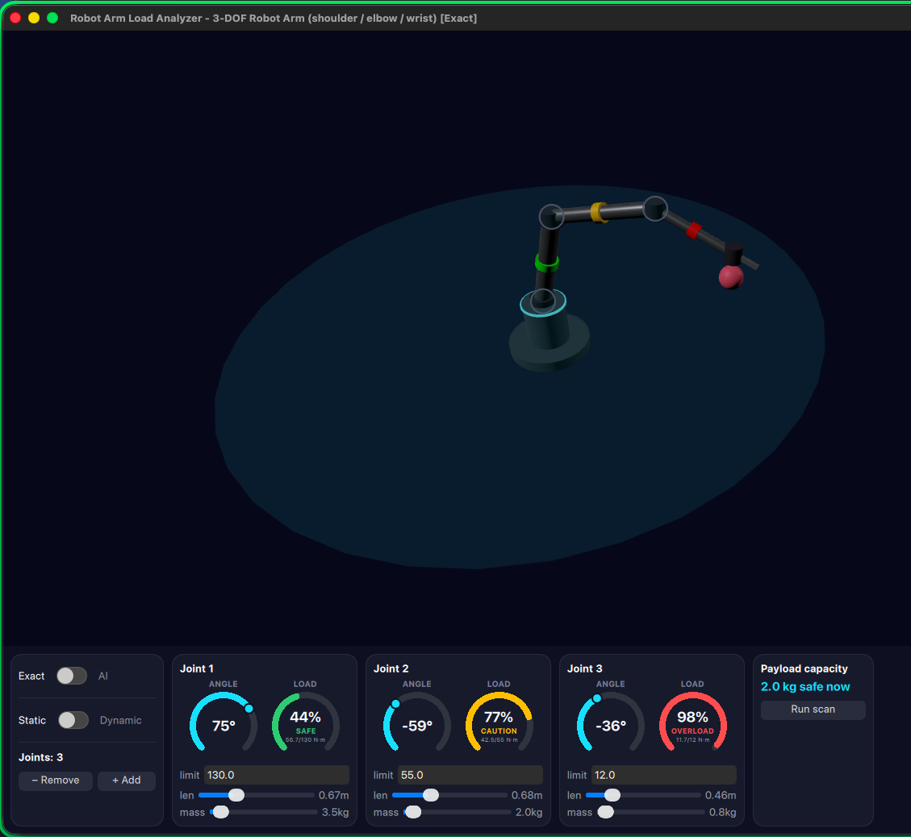
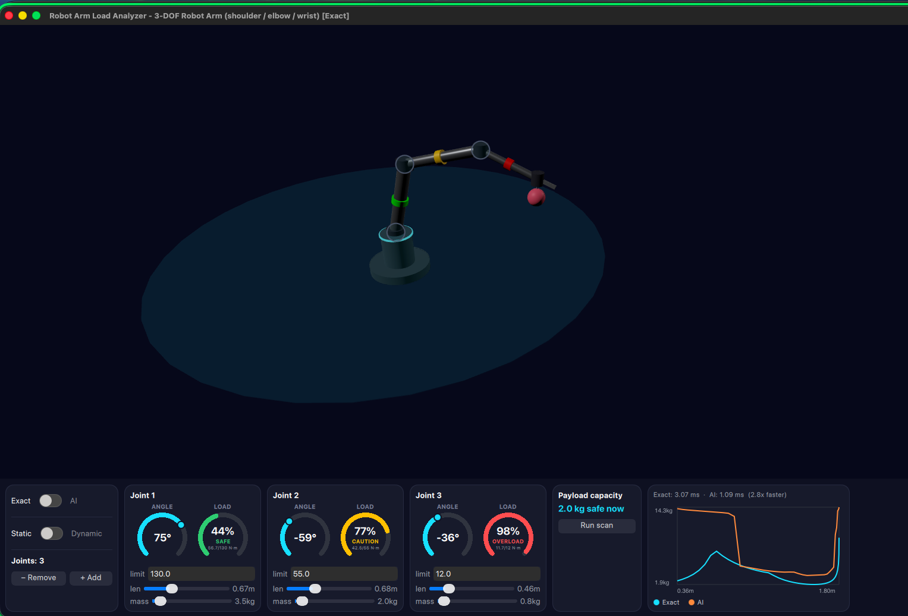
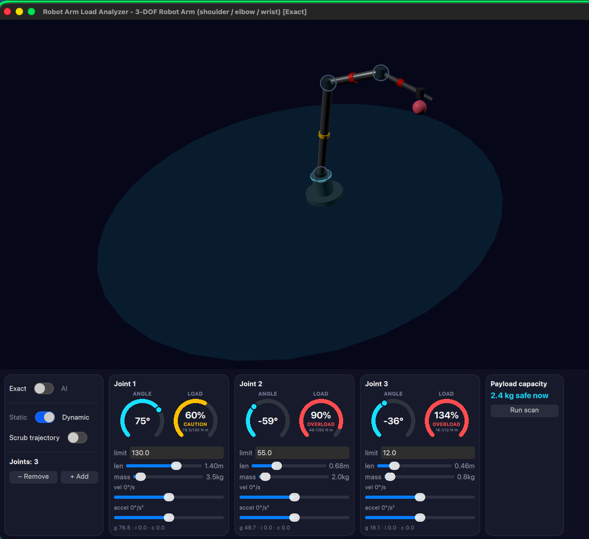
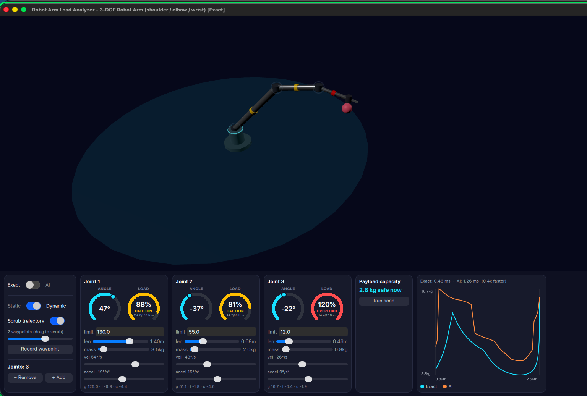
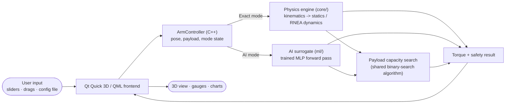
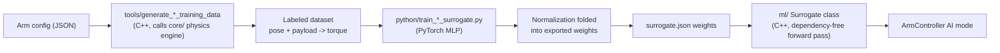

# Robot Arm Load Analyzer

**An interactive physics + AI tool for answering one question instantly: is this robot-arm pose, with this payload, actually safe to hold?**

Built from scratch in C++ (kinematics, statics, full rigid-body dynamics), with a PyTorch-trained neural-network surrogate for the same torque computation, and a real-time Qt Quick 3D interface where every joint, link, and payload parameter is a live, draggable control.


---

## Why this exists

Every joint on a robot arm is driven by a motor with a hard torque limit. Exceed it anywhere in the chain and the joint stalls, strains, or fails. Industrial manufacturers answer "how much can this arm safely carry, and where" once, at design time, with a payload-vs-reach curve printed on a spec sheet — accurate for exactly one arm, built exactly as specified. It can't answer "what if this link were longer," "what if this joint were heavier," or "what if I used a different pose," because each of those needs the dynamics re-derived by hand.

This project removes that barrier: the arm's own geometry, mass, and payload are all editable live, and every "what if" is answered the instant it's asked — by dragging a slider, not by opening a textbook.

## What makes it interesting

- **A real physics engine, not a wrapper.** Forward/inverse kinematics (Denavit-Hartenberg + damped least-squares IK), Jacobian-transpose statics, and a full Recursive Newton-Euler dynamics derivation (gravity/inertia/Coriolis, individually decomposed and verified to sum exactly back to the total) — all written from first principles in C++ with Eigen.
- **An AI surrogate that's measured, not just claimed.** A small PyTorch-trained MLP approximates the same torque function and runs through a dependency-free, hand-written C++ forward pass. A workspace scan is exactly the regime it's built for — hundreds of torque evaluations per click — and every scan reports **real, measured timing for both paths side by side**: the AI surrogate measured **2.8× faster** than the exact engine, with curves that nearly overlap.
- **A genuinely editable arm.** Joint count, link length, link mass, and torque limits are all live controls — not configuration you edit offline and reload. The 3D model, every torque number, and the reach envelope recompute immediately.
- **Direct 3D manipulation.** Every joint is a draggable handle right in the 3D view, in addition to the sidebar controls.
- **A payload-capacity workspace scan** that reproduces a manufacturer's load-moment diagram, computed live, through both engines, with timing — the concrete answer to "why use an AI model here at all?"

## See it in action

|                                                                                                                                                                 |                                                                                                                                                                       |
| --------------------------------------------------------------------------------------------------------------------------------------------------------------- | --------------------------------------------------------------------------------------------------------------------------------------------------------------------- |
|  Direct 3D joint manipulation — drag any joint ring in the 3D view itself.                       |  Staging a payload and closing the gripper attaches it instantly; every joint's load gauge updates in real time.    |
|  Dragging a joint's length live — the SAFE/CAUTION/OVERLOAD gauges respond immediately.        |  Pushed into OVERLOAD — the same safety signal a real motor's torque limit would trip.                                              |
|  A workspace scan: the AI surrogate measured 2.8× faster than the exact engine, curves nearly overlapping. |  Dynamic mode: torque broken into gravity, inertia, and Coriolis contributions per joint. |
|  A recorded multi-waypoint trajectory, scrubbed smoothly with live velocity/acceleration.                          |                                                                                                                                                         |

## Architecture

The application is split into three independent pieces that only ever share data through plain primitive types — never an internal C++ or ML-framework object crossing a boundary directly. That separation is what makes the Exact/AI comparison meaningful: both engines are called through the exact same interface, so switching between them (or benchmarking them) is a pure substitution.



| Layer                | Path            | Responsibility                                                                                                                                                    |
| -------------------- | --------------- | ----------------------------------------------------------------------------------------------------------------------------------------------------------------- |
| Physics engine       | [`core/`](core) | C++17 + Eigen. Kinematics, statics, full RNEA dynamics, inverse kinematics, payload capacity search. No UI or ML dependency; unit-tested on its own.              |
| AI surrogate         | [`ml/`](ml)     | A trained MLP, plus a small hand-written, dependency-free C++ inference class. A drop-in alternative torque evaluator trained on the physics engine's own output. |
| Interactive frontend | [`app/`](app)   | Qt Quick 3D / QML. A thin `ArmController` exposes only plain Qt types to QML — the 3D scene and sidebar never touch an Eigen matrix or a PyTorch tensor directly. |

### How the AI surrogate is trained

Training labels are generated by calling the exact physics engine directly from C++ — never re-derived in Python — so the network is always learning this project's own physics, not a second, possibly-inconsistent implementation of it.



Input/output normalization is folded directly into the exported weights, so the C++ inference path is a single dependency-free forward pass — no PyTorch, no ONNX runtime, just matrix multiplication at inference time. A separate, larger network is trained for dynamic mode, since dynamic torque (position + velocity + acceleration + payload) is a harder function to approximate.

## Tech stack

- **C++17**, **Eigen** (linear algebra), **nlohmann/json** (config I/O), **GoogleTest** (via CMake `FetchContent`)
- **Qt 6 / Qt Quick 3D / QML** for the real-time interactive interface
- **PyTorch** (training) + a hand-written C++ inference class (runtime) for the AI surrogate
- **CMake** build system

## Building and running

Requires Qt 6.5+ (Quick 3D + Quick Dialogs 2), Eigen3, and nlohmann-json on your system.

```bash
cmake -B build -DCMAKE_PREFIX_PATH=/path/to/Qt  # e.g. /usr/local/Qt-6.10.0
cmake --build build
./build/bin/robotarm_app
```

### Running the tests

```bash
ctest --test-dir build
```

148 GoogleTest cases across 14 executables, covering every physics module (kinematics, statics, dynamics, trajectories, inverse kinematics, payload capacity, the AI surrogate, config parsing) plus the Qt-facing controller layer.

### Retraining the AI surrogate (optional)

```bash
python3 -m venv python/.venv && source python/.venv/bin/activate
pip install -r python/requirements.txt
./build/bin/generate_training_data            # writes labeled data via the exact engine
python3 python/train_surrogate.py             # trains + exports ml/models/*.surrogate.json
```

## Project structure

```
core/     physics engine - kinematics, statics, RNEA dynamics, IK, payload capacity (C++17/Eigen)
ml/       AI surrogate - C++ inference class + trained weights
app/      Qt Quick 3D / QML interface + ArmController bridge
tools/    C++ training-data generators (reuse the exact physics engine)
python/   PyTorch training scripts
tests/    GoogleTest suite (148 cases / 14 executables)
config/   example arm configurations (JSON)
```

## License

Released under the [MIT License](LICENSE).
