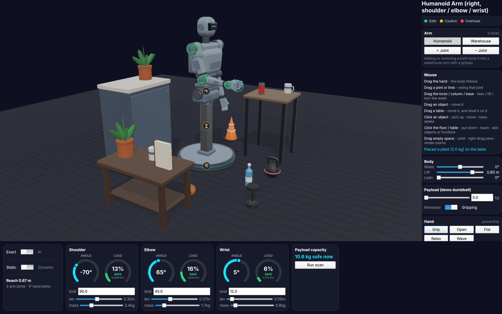
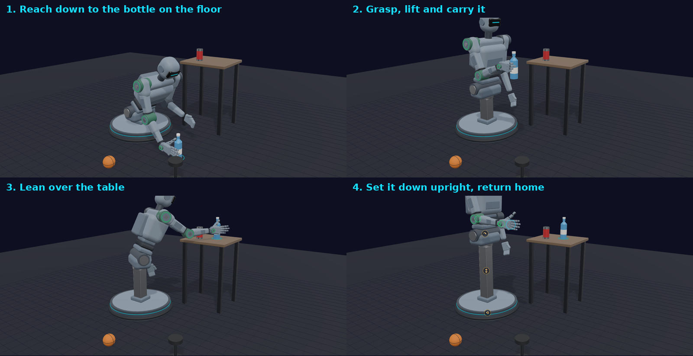
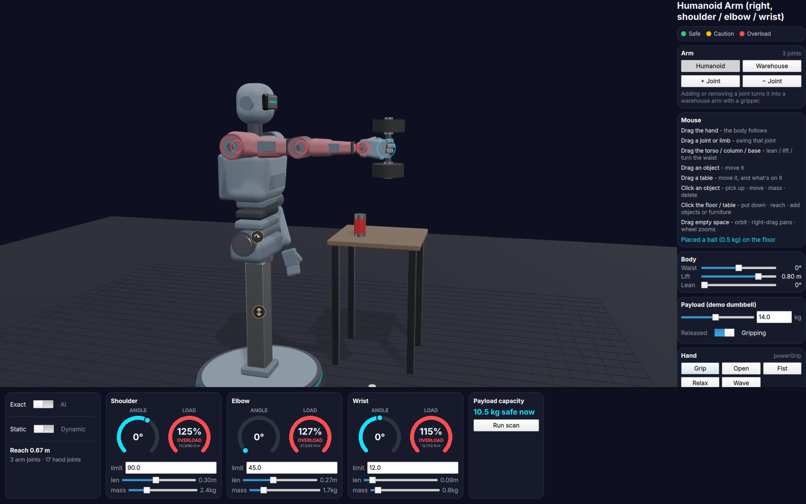
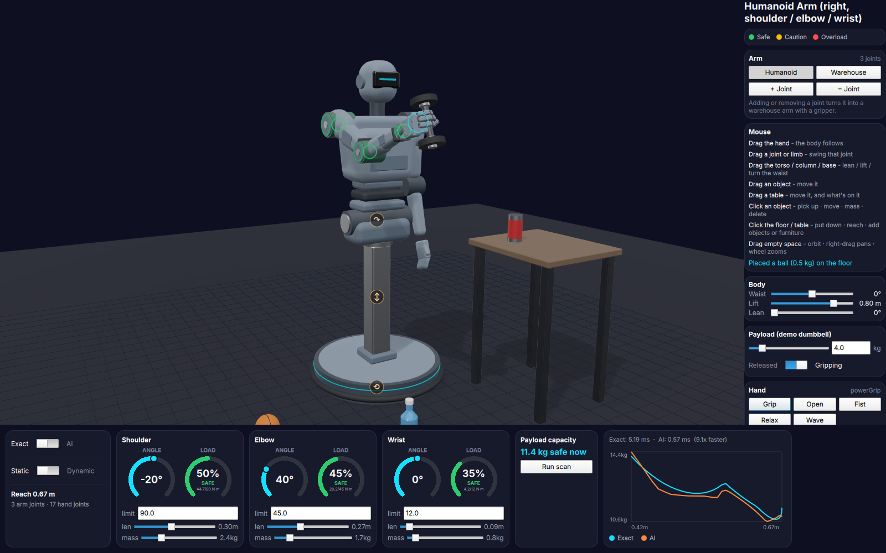
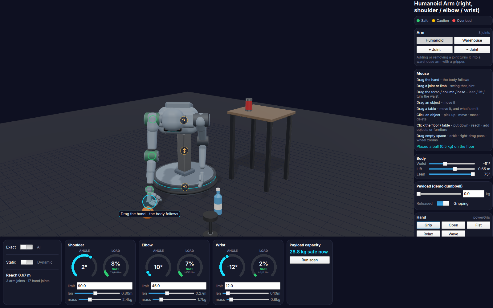
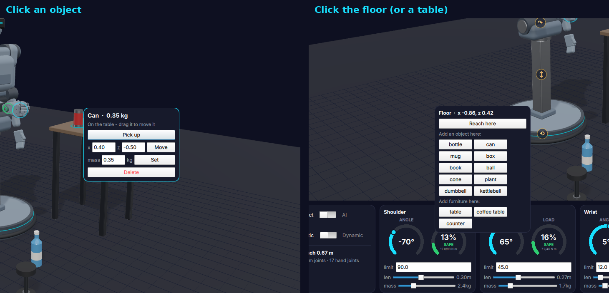
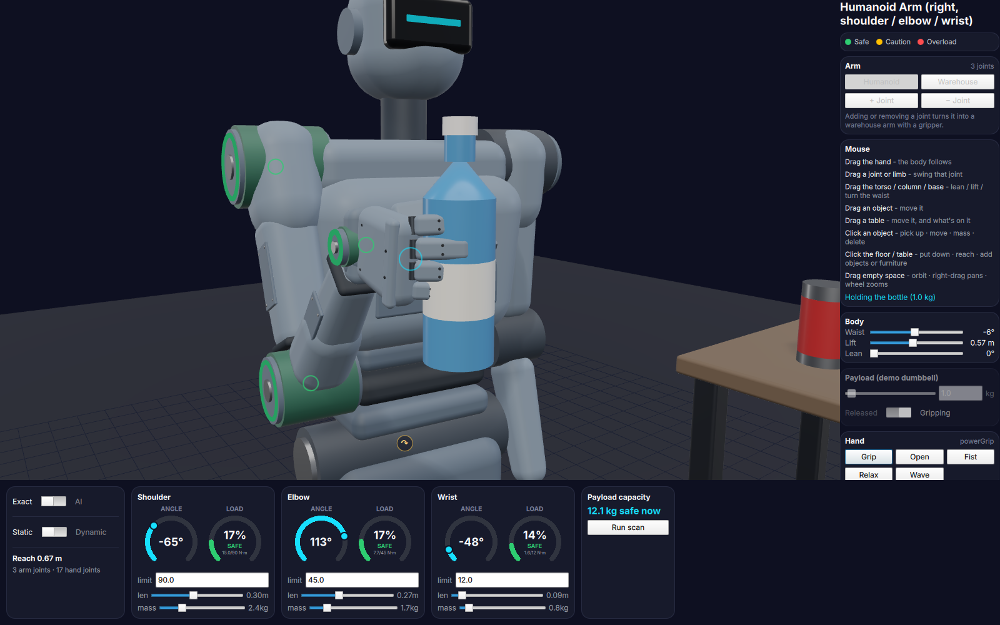
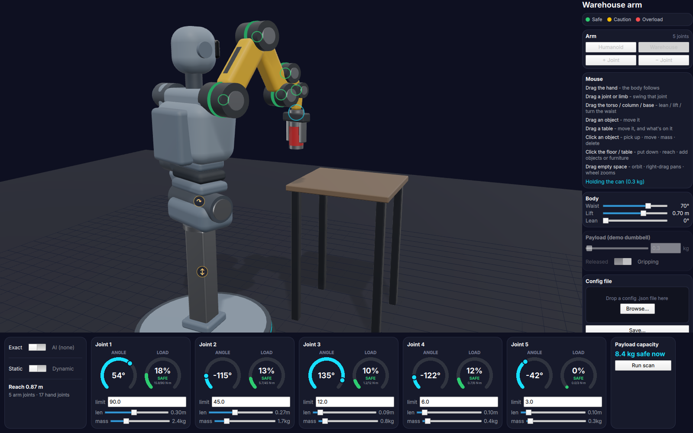
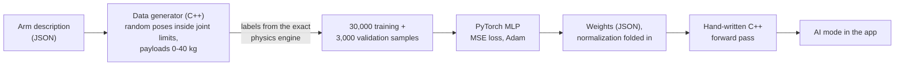
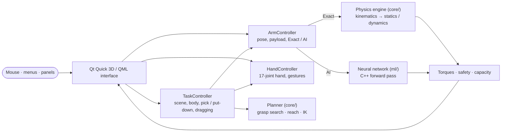

# Humanoid Arm Load Analyzer

**Can this robot hold that weight, in that pose, without overloading a joint, and can it go and pick the object up?**

A humanoid robot on a mobile lift base, simulated in real time. You put objects on the floor and on tables, drag the robot around with the mouse, and ask it to pick things up. Every joint's load is computed live: by an exact physics engine, or by a **neural network trained to imitate it**.

> **Midterm project, Introduction to Artificial Intelligence**, by **HSley13**



---

## Contents

- [What it does](#what-it-does)
- [Where the AI is](#where-the-ai-is)
- [How it works](#how-it-works)
- [Using it](#using-it)
- [Tech stack](#tech-stack)
- [Building and running](#building-and-running)
- [Tests](#tests)
- [Retraining the neural network](#retraining-the-neural-network)
- [Project structure](#project-structure)

---

## What it does

### Picks things up, planned with the physics

Click an object, choose *Pick up*, and the robot works out how to reach it. It turns its waist toward it, lowers the lift, leans at the hip, and solves the arm's joint angles with the hand kept upright. Among all the poses that work, it prefers the one that loads the joints least. Then it approaches, grasps, lifts, carries, and puts the object down wherever you click. If it can't, it says why, for example *"too heavy - Shoulder would need 112 N·m (limit 90)"*.



While the robot holds an object, that object's mass is the arm's payload, so every gauge shows what the robot is really carrying.

### Shows when a joint is overloaded

Each joint has a motor with a torque limit. The gauges, the joint housings and the limbs turn **green** (under 60 % of the limit), **amber** (60-90 %) or **red** (90 % and above).



### Exact physics vs. a neural network

The same torque computation runs two ways: the exact physics engine, and a small neural network trained on that engine's output. The *Payload capacity* scan sweeps the arm from stretched out to folded, asks both "how many kg can it hold here?", and plots them on the same chart with their measured running times.



The neural network's curve follows the exact one closely and is about **9× faster** (0.57 ms vs. 5.19 ms for 40 poses in the run above).

### Driven with the mouse

Grab the hand and drag it anywhere. The robot plans a whole-body pose for that point and **moves** there at speeds its joints could manage: it turns, crouches and leans, all parts finishing together, with no jumps. You can also grab the torso, the lift column or the round base to lean, lift or turn the waist yourself.



Click an object or a spot to get a menu:



### A five-finger hand, or a warehouse gripper

The hand has 17 joints and closes its fingers to fit each object's size.



Add or remove a joint (or press *Warehouse*) and the right arm becomes an industrial arm with as many joints as you like and a two-finger gripper. It grasps from above when it can and from the side otherwise. *Humanoid* brings the human arm back.



### A scene you can build

Ten kinds of objects: bottle, can, mug, box, book, ball, traffic cone, potted plant, dumbbell and kettlebell (its color band follows its weight). Three kinds of furniture: table, low coffee table and kitchen-height counter. Add as many as you like, drag them around (whatever stands on a table moves with it), change any object's mass.

---

## Where the AI is

This project touches several of the main ideas of an introductory AI course.

### 1. The robot as an intelligent agent

| PEAS            | In this project                                                                                                         |
| --------------- | ----------------------------------------------------------------------------------------------------------------------- |
| **Performance** | Reach the goal (grasp the object, put it where asked) without exceeding any joint's torque limit or its range of motion |
| **Environment** | Floor, tables, coffee tables, counters and objects of different shapes and masses, all placed by the user                   |
| **Actuators**   | Waist (turn), lift (up/down), hip (lean), arm joints, 17 finger joints or a gripper                                     |
| **Sensors**     | Object positions and sizes, the robot's own joint angles, and the torque each joint must produce                        |

Each request is a **perceive → plan → act** cycle. The robot reads where the object is, plans a sequence of poses, then executes them with smooth, speed-limited motion. If the plan fails, it reports the reason instead of acting.

### 2. Supervised learning: a neural network that imitates physics

Computing joint torques exactly means walking the whole arm (kinematics, Jacobians, masses) for every pose. A **neural network** can learn the mapping *pose + payload → torques* and answer in one cheap forward pass.



| | Static model | Dynamic model |
| --- | --- | --- |
| Input | 3 joint angles + payload (4) | angles, velocities, accelerations + payload (10) |
| Network | 4 → 32 → 32 → 3, ReLU | 10 → 96 → 96 → 3, ReLU |
| Output | 3 joint torques (N·m) | 3 joint torques (N·m) |
| Validation mean abs. error | **1.15 N·m** (≈1.3 % of the shoulder's 90 N·m limit) | **0.86 N·m** |
| Validation max abs. error | 19.9 N·m | 16.6 N·m |

- **Labels come from the project's own physics engine**, called from C++, never re-derived in Python, so the network learns exactly the function it replaces.
- **Training:** full-batch Adam (learning rate 10⁻³, step decay) on mean squared error, with inputs and outputs normalized. The normalization is then folded into the first and last layers, so the C++ side is just three matrix multiplies and two ReLUs, with no ML library at runtime.
- **Generalization has limits, and the app respects them.** The network was trained for one arm. Change a limb's length or mass, or add a joint, and the training data no longer describes the arm. AI mode then switches off and the exact engine takes over, a concrete case of distribution shift.

### 3. Search

- **Payload capacity is a binary search.** It finds the largest payload whose torques stay within every joint's limit, using either the exact engine or the neural network as the evaluator.
- **Grasp planning is generate-and-test search over body poses.** The candidates are a grid of lift heights × hip leans: every 2 cm × 5° for the humanoid arm, every 5 cm × 7.5° for other joint counts, where each candidate costs a numeric IK solve. For each, the waist yaw and the arm's angles are solved, and the pose is checked against the constraints: joint ranges, the floor, torque limits, and the hand's required orientation. The poses that pass are scored by a cost function: mainly the peak joint load (lightest wins), plus small penalties for leaning, for tilting the hand away from its preferred angle, and for moving the lift far. Grasp *options* are searched in order too: the gripper tries from above before from the side.
- **Reaching for a dragged point is a cost-based choice.** The robot prefers the pose that changes its body least (waist turn, lift, lean and arm all weighted). Past its reach, it picks the posture that gets closest *without* swinging to a very different one from one mouse move to the next.

### 4. Optimization

- **Inverse kinematics** (which joint angles put the hand *here*?) minimizes the distance to the target with **damped least squares**, a Gauss-Newton / Levenberg-Marquardt step: Δq = Jᵀ(JJᵀ + λ²I)⁻¹ e. Joints that hit their limit are frozen and the rest re-solve (an active-set method).
- For the humanoid's three-joint arm with the hand's angle fixed, there is also a **closed-form** solution. The planner uses it because it's exact and instant, and falls back to the numeric solver for any other joint count.

### 5. Planning and acting

A pick-up is a short plan of sub-goals: **approach → grasp → lift → carry**. A put-down is **move above → lower → release → retreat → home**. Each step is a target pose; the controller interpolates between them with eased motion, closes the hand or gripper at the right moment, and hands the object's mass to the physics as payload. Some steps are planned only when reached (the home pose is computed from wherever the arm actually ended up), which is a small form of replanning.

---

## How it works



**Physics engine (`core/`, C++17 + Eigen, written from first principles):**

- **Kinematics:** each joint is described with Denavit-Hartenberg parameters; forward kinematics chains the transforms to get every joint's position. The hand is a kinematic *tree*: five finger chains branch off the wrist, each placed in the palm with a URDF-style origin (needed for the off-axis thumb).
- **Statics:** the torque each joint needs to hold the pose, from the weight of every link and the payload, through the arm's Jacobian.
- **Dynamics:** the full Recursive Newton-Euler algorithm, with gravity, inertia and Coriolis terms computed separately (tests check they add up exactly to the total).
- **The body:** turning the waist and raising the lift don't change gravity torques. Leaning at the hip tilts the arm within its own plane, which is the same as rotating gravity in the arm's frame, so the analysis stays exact while the robot crouches and leans.

**The interface (`app/`, Qt 6 Quick 3D):**

- The robot, objects and furniture are built from procedural meshes (rounded shells, tubes) written in C++, and every part is placed from the forward kinematics. Change a limb length and the model follows.
- The C++ controllers are exposed to QML as a QML module (`Humanoid.Backend`, using `QML_ELEMENT` + `QML_SINGLETON`). QML binds to their properties and calls their slots.
- The mouse layer works out what a press grabbed (hand, joint, limb, torso, column, base, object, table or empty space) and turns mouse motion into joint motion through each point's on-screen velocity, so dragging feels right from any camera angle.
- **QML hot reload:** save any `.qml` file and the window reloads in place, keeping the robot's state.

### Robot specification

| Part | Details |
| --- | --- |
| Arm | shoulder / elbow / wrist: 0.30 m upper arm, 0.27 m forearm, 0.09 m hand link; torque limits 90 / 45 / 12 N·m |
| Joint ranges | human-like: the elbow only bends one way, enforced everywhere, including inverse kinematics |
| Hand | 17 joints: wrist roll + deviation, 5 fingers (the thumb on its own opposable base) |
| Body | waist turn ±160°, lift 0.25-0.95 m (hip height), hip lean 0-75° |
| Configs | [`config/humanoid_arm.json`](config/humanoid_arm.json), [`config/humanoid_hand.json`](config/humanoid_hand.json) |

---

## Using it

| Mouse                              | Does                                                    |
| ---------------------------------- | ------------------------------------------------------- |
| Drag the **hand** (cyan circle)    | The whole body follows                                  |
| Drag a **joint** or a **limb**     | Swings that joint                                       |
| Drag the **torso / column / base** (amber handles) | Lean / lift / turn the waist           |
| Drag an **object** or a **table**  | Moves it (a table carries what's on it)                 |
| Click an **object**                | Pick up · move to x, z · set mass · delete              |
| Click the **floor** or a **table** | Put down here · reach here · add an object or furniture |
| Drag empty space                   | Orbit the camera; right-drag pans; the wheel zooms      |

The side panel switches **Humanoid / Warehouse**, adds or removes joints, and has sliders for the body, a demo payload and hand gestures. Each card in the bottom bar is one joint: its angle, its load gauge, and editable torque limit, length and mass. The bottom-left switches choose **Exact / AI** and **Static / Dynamic**.

---

## Tech stack

| Technology | Used for |
| --- | --- |
| **C++17** | physics engine, planner, neural-network inference, application |
| **Eigen** | linear algebra (transforms, Jacobians, least squares) |
| **Qt 6 · Qt Quick 3D · QML** | real-time 3D interface, procedural meshes, image-based lighting |
| **PyTorch · NumPy** | training the neural networks |
| **nlohmann/json** | robot configs and network weights |
| **GoogleTest** | 256 unit and integration tests |
| **CMake** | build (with `qt_add_qml_module`) |

---

## Building and running

Requires a C++17 compiler, CMake ≥ 3.21, Qt 6.5+ (Quick, Quick 3D, Quick Controls 2, Quick Dialogs 2), Eigen 3 and nlohmann-json.

```bash
cmake -B build -DCMAKE_PREFIX_PATH=/path/to/Qt    # e.g. /usr/local/Qt-6.10.0
cmake --build build
./build/bin/robotarm_app
```

On macOS with Homebrew this works even if Homebrew also has a different Qt installed, and from folders whose path contains spaces. The build includes workarounds for both.

Optional launch flags, mostly for reproducible scenes and screenshots:

```bash
./build/bin/robotarm_app --pose -35,80,-10 --payload 6                 # arm angles (deg), kg in the hand
./build/bin/robotarm_app --pick 1 --put 0.55,-0.6                      # scripted pick-up and put-down
./build/bin/robotarm_app --industrial 5 --pick 3                       # 5-joint warehouse arm picks the can
./build/bin/robotarm_app --table "counter,-0.55,0.45" --add "plant,-0.55,0.30"
./build/bin/robotarm_app --scan 40 --camera 60,-10,2.4 --screenshot shot.png
```

## Tests

```bash
ctest --test-dir build
```

256 tests in 20 suites cover every physics module (kinematics, kinematic trees, statics, dynamics, trajectories, inverse kinematics, payload capacity, grasp and reach planning, the neural-network surrogates, config parsing). They also cover the application layer, including whole pick-and-place sequences stepped in simulated time with both the hand and the gripper, for every object type, and QML loading the C++ module.

## Retraining the neural network

```bash
python3 -m venv python/.venv && source python/.venv/bin/activate
pip install -r python/requirements.txt
./build/bin/generate_training_data config/humanoid_arm.json python/data/humanoid_arm_train.csv 30000 1 0 -9.81 0 40
./build/bin/generate_training_data config/humanoid_arm.json python/data/humanoid_arm_val.csv 3000 2 0 -9.81 0 40
python3 python/train_surrogate.py --arm-name humanoid_arm --num-joints 3 --hidden-dim 32
```

The generator's arguments are: config, output file, number of samples, random seed, gravity vector, maximum payload in kg. `train_dynamic_surrogate.py` and `generate_dynamic_training_data` do the same for the dynamic model.

## Project structure

```
core/       physics engine: kinematics, kinematic tree, statics, dynamics, IK, payload capacity, planner
ml/         neural-network inference (C++) + trained weights
app/        Qt Quick 3D interface, the C++ controllers, procedural meshes (app/geometry/)
config/     the robot's arm and hand
tools/      training-data generators (call the physics engine), lighting generator
python/     PyTorch training scripts
tests/      GoogleTest suites
image/      screenshots used in this README
archive/    the project's earlier industrial 3-DOF arm (not used by the app)
```

## Author

**HSley13**

## License

Released under the [MIT License](LICENSE).
