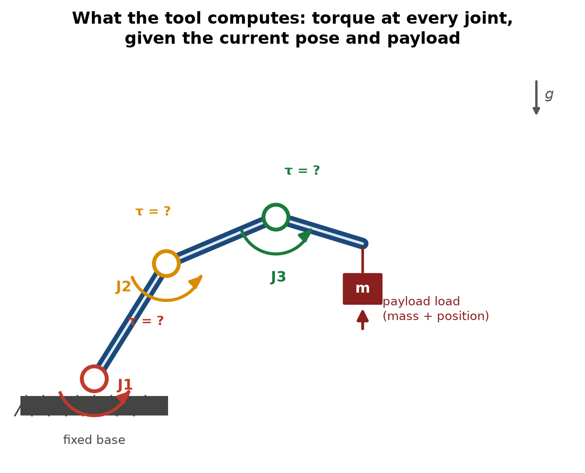
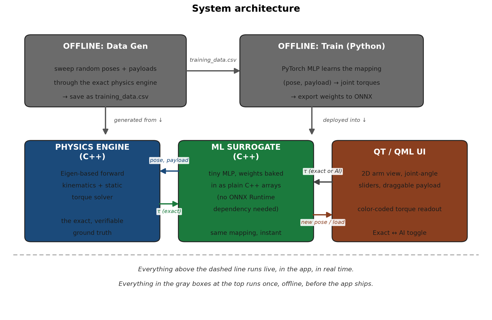
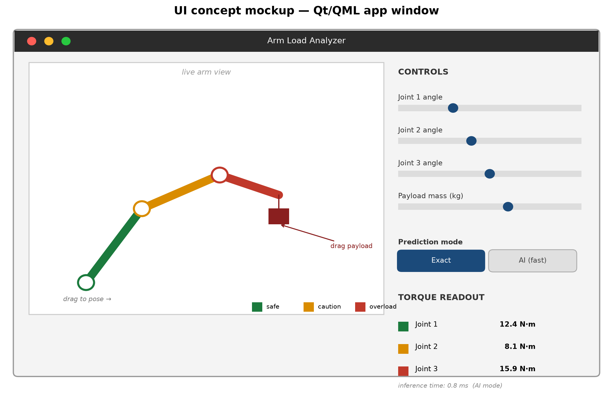

# Robot Arm Load Analyzer — Project Plan

**Intro to AI — Midterm Project**

A real-time tool that tells you how much torque is at each joint of a robot arm, given its current pose and a payload — the same idea as a bridge-load analyzer (put load on nodes, see how the structure reacts), applied to a robot arm instead of a bridge. You pick the pose and the payload; the tool computes the stress on every joint — fast enough to explore thousands of configurations interactively, fed by a small AI model trained to approximate the exact physics.

---

## 1. The Core Idea



A robot arm is a chain of rigid links connected by joints (motors). When you hold a payload out at the end of the arm, every joint along the way has to fight gravity to hold that pose — the joint closest to the base usually works hardest, since it's carrying the weight of every link _and_ the payload, at the longest lever arm.

This is exactly the same kind of problem as a truss under load: given a structure and a load, compute the internal force/stress at every connection point. A civil engineer does this for a bridge's nodes; this tool does it for a robot arm's joints — same underlying idea (static equilibrium — sum of moments = 0 at every pivot), different field.

**Why this is general, not a toy for one specific arm:** the arm is _defined by data_ (number of joints, link lengths, link masses, per-joint torque limits), not hardcoded. Any serial-link robot arm — a 2-joint desk arm, a 6-joint industrial arm, a hobbyist 3D-printed arm — can be described with the same handful of numbers and dropped into the same tool. That's what makes it broadly useful instead of a one-off demo: a hobbyist designing a 3D-printed arm, a student picking motors for a class project, or a robotics club building their first manipulator can all use it to answer "will this joint survive this payload at this pose?" _before_ they build anything or burn out a motor.

---

## 2. The Physics (the "precise" part)

For a planar (2D) arm, the position of every joint comes from simple forward kinematics — walk along the chain, accumulating each link's rotation and length:

```
x_i = x_0 + sum_{k=1}^{i} L_k * cos(theta_1 + theta_2 + ... + theta_k)
y_i = y_0 + sum_{k=1}^{i} L_k * sin(theta_1 + theta_2 + ... + theta_k)
```

The torque at joint _i_ is just the **sum of moments** about that joint — exactly the statics calculation behind the bridge-load tool. Since gravity pulls straight down, only the _horizontal_ distance from the joint to each weight matters (that horizontal distance is the "lever arm"):

```
tau_i = sum over every link j beyond joint i:  m_j * g * (x_cm_j - x_i)
      + (if the payload is beyond joint i):    m_payload * g * (x_payload - x_i)
```

This is the **exact, verifiable ground truth** — you can check it by hand on a 2-joint arm in about five minutes, which matters: it's both the thing the tool reports in "Exact" mode, and the thing used to generate training data for the AI model (next section).

---

## 3. Where the AI Comes In

The physics above is exact but means re-deriving/recomputing every time something changes. The AI angle: train a small neural network to **learn the same mapping** — (joint angles, payload) → (torque at every joint) — so you can evaluate thousands of configurations instantly instead of recomputing the chain each time. This is a legitimate, real engineering technique (a "surrogate model" / "learned simulator"), not a gimmick — it's exactly how real engineering teams speed up expensive simulations.

- **Training data**: generate it yourself. Sweep random combinations of joint angles and payloads through the _exact_ physics engine, save (input → output) pairs. No manual data collection needed — the exact formula above _is_ the data generator.
- **Model**: a small multi-layer perceptron (MLP) — a few hundred parameters is enough for a 3-joint arm. Train in Python (PyTorch), since Python's ML tooling is far faster to iterate in than C++.
- **Deployment**: here's the practical shortcut — for a model this small, **skip ONNX Runtime entirely**. Export the trained weights as plain arrays and write ~20 lines of C++ to do the matrix multiplications by hand. You get a real trained neural network running in your C++ app with zero extra library dependencies, and you sidestep the part most likely to eat a full day of setup/linking friction under time pressure. (If you have time left over, swapping in ONNX Runtime later is a clean, well-documented upgrade — a good "future work" item.)
- **The payoff in the UI**: a toggle between "Exact" (calls the physics engine) and "AI" (calls the trained model), so you can visibly demonstrate the model is both fast _and_ accurate — a genuinely nice demo moment for an AI class.

---

## 4. System Architecture



Three pieces run live inside the app, cleanly separated so each can be worked on (and later extended by someone else) independently:

- **Physics Engine (C++)** — the exact calculation from Section 2. Also used offline to generate training data.
- **ML Surrogate (C++)** — the trained model, running inference with no training code anywhere near the shipped app.
- **Qt/QML UI** — renders the arm, takes pose/payload input, shows the result.

This separation is also what makes the project **extensible for others later**: someone could swap in a better model without touching the UI, build a different front-end against the same physics engine, or extend the physics engine to 3D without touching the ML code — because none of the three pieces know about the others' internals, only about the data passed between them.

---

## 5. The Real-Time UI



This is a concept mockup, not a screenshot — it shows the intended layout, not final styling.

- **Left**: the arm, drawn live. Each link is color-coded by how close its joint is to its rated torque limit (green → safe, amber → caution, red → overload) — an instant visual answer to "is this configuration dangerous," which is the whole point of the tool.
- **Right**: sliders for each joint angle and the payload mass, a numeric torque readout per joint, and the Exact ↔ AI toggle.
- QML's property-binding model is what makes "live" cheap here: bind the arm's drawn geometry and the color-coded joints directly to the pose/payload values, and dragging a slider updates everything automatically — no manual redraw loop to write.

---

## 6. Tech Stack

| Piece                         | Choice                                            | Why                                                                                                                                                                                   |
| ----------------------------- | ------------------------------------------------- | ------------------------------------------------------------------------------------------------------------------------------------------------------------------------------------- |
| UI                            | **Qt / QML**                                      | Declarative, property-bound — "recompute and redraw on change" is nearly free. Used in real industrial/CAD software, not just demos.                                                  |
| Core math                     | **C++ with Eigen**                                | Eigen is the standard C++ linear-algebra library — clean, fast, well-documented, handles the kinematics chain naturally.                                                              |
| Model training                | **Python + PyTorch**                              | Python's ML tooling (data generation, training loop, debugging) is far faster to iterate in than doing the same in C++. This part never ships — it just produces the trained weights. |
| Model inference (shipped app) | **Hand-written C++ (preferred)**, or ONNX Runtime | See Section 3 — for a model this small, skip the extra dependency unless you have spare time.                                                                                         |
| Build system                  | **CMake**                                         | Standard for Qt + C++ projects, plays well with Eigen.                                                                                                                                |

**Is C++ + Qt/QML a good choice here?** Yes — it's a legitimately strong choice, not just a safe one. The main risk given a one-week timeline is scope, not the stack itself: **build the 2D version first.** Qt Quick 3D exists and is a clean upgrade path later, but it's a real time sink you don't need to prove the concept. A 2D planar arm (2–3 joints) demonstrates everything — the physics, the AI surrogate, the real-time UI — without the extra weeks 3D rendering, lighting, and camera controls would cost.

---

## 7. What You'll Need

- Qt 6 (Qt Quick / QML) — install via the Qt online installer or your package manager
- A C++17-capable compiler + CMake
- [Eigen](https://eigen.tuxfamily.org/) (header-only — just drop it in, no build step)
- Python 3 + PyTorch, for the offline training step only (not part of the shipped app)
- _(Optional, future work)_ ONNX Runtime C++ package, only if you outgrow the hand-written inference approach
- _(Optional)_ [nlohmann/json](https://github.com/nlohmann/json) — the cleanest way to load an arm's definition (joints, link lengths, masses, torque limits) from a config file, which is what makes the tool work for _any_ arm instead of one hardcoded one

---

## 8. Build Plan (one week)

| Day   | Goal                                                                                                                                                                                                                     |
| ----- | ------------------------------------------------------------------------------------------------------------------------------------------------------------------------------------------------------------------------ |
| **1** | Physics engine: N-joint planar arm, forward kinematics + the torque formula from Section 2. Verify by hand on a 2-joint example — this is your "precise" guarantee.                                                      |
| **2** | Generate training data (sweep poses/payloads through the physics engine), train the MLP in PyTorch, export weights, hand-write the C++ inference function. Check AI-mode output against Exact-mode on held-out examples. |
| **3** | Qt/QML UI skeleton: draw the arm in 2D, wire up sliders for joint angles and payload, connect to the C++ physics engine for live torque numbers.                                                                         |
| **4** | Wire in the AI-mode inference path, add the Exact/AI toggle, add color-coded torque thresholds (green/amber/red) driven by per-joint limits from the arm config.                                                         |
| **5** | Config-file support so the arm itself is swappable (not hardcoded) — this is what makes the generality/extensibility claim real, not just a talking point. Polish, write the README, record the demo video.              |

---

## 9. Making It General & Extensible for Others

- **Define the arm via a config file** (JSON: number of joints, link lengths, link masses, per-joint torque limits) instead of hardcoding one arm. This alone is what turns "a tool for my specific arm" into "a tool anyone with a serial-link arm can point at their own design."
- **Keep the three layers (physics / ML / UI) strictly separated**, communicating only through plain data (pose, payload, torques) — so someone else could later swap in a better model, extend the physics to 3D, or build a web front-end against the same C++ physics core, without needing to understand or touch the other layers.
- **Document the config format and the exact-vs-AI contract** in the README, so a future contributor (or future you) knows exactly what inputs/outputs each layer expects.

## 10. Stretch Goals / Future Work

(Explicitly out of scope for the week — listed so the project has an obvious "here's what's next" story, which is also exactly what makes it something others could build on.)

- 3D visualization via Qt Quick 3D
- Non-planar (3D) arms, full Denavit–Hartenberg kinematics
- Dynamic (moving, not just static-holding) load analysis
- ONNX Runtime swap-in for larger/more complex models
- Saving/loading arm configurations from the UI directly, not just a config file
