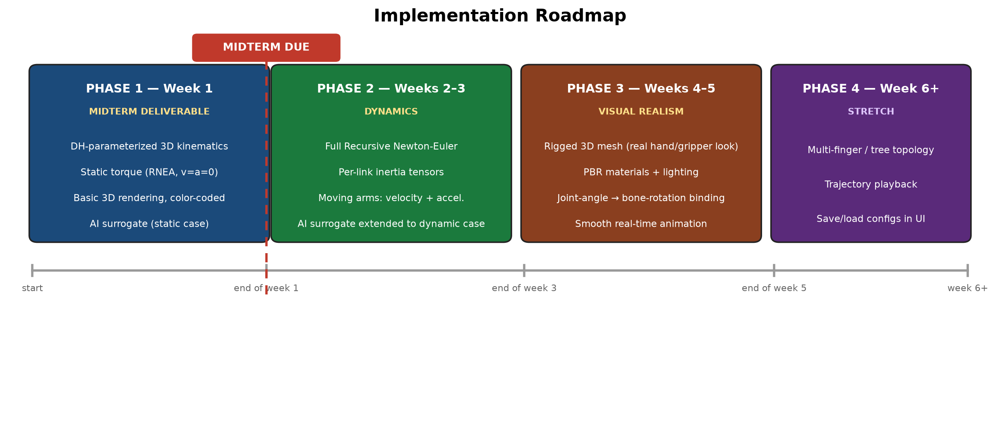
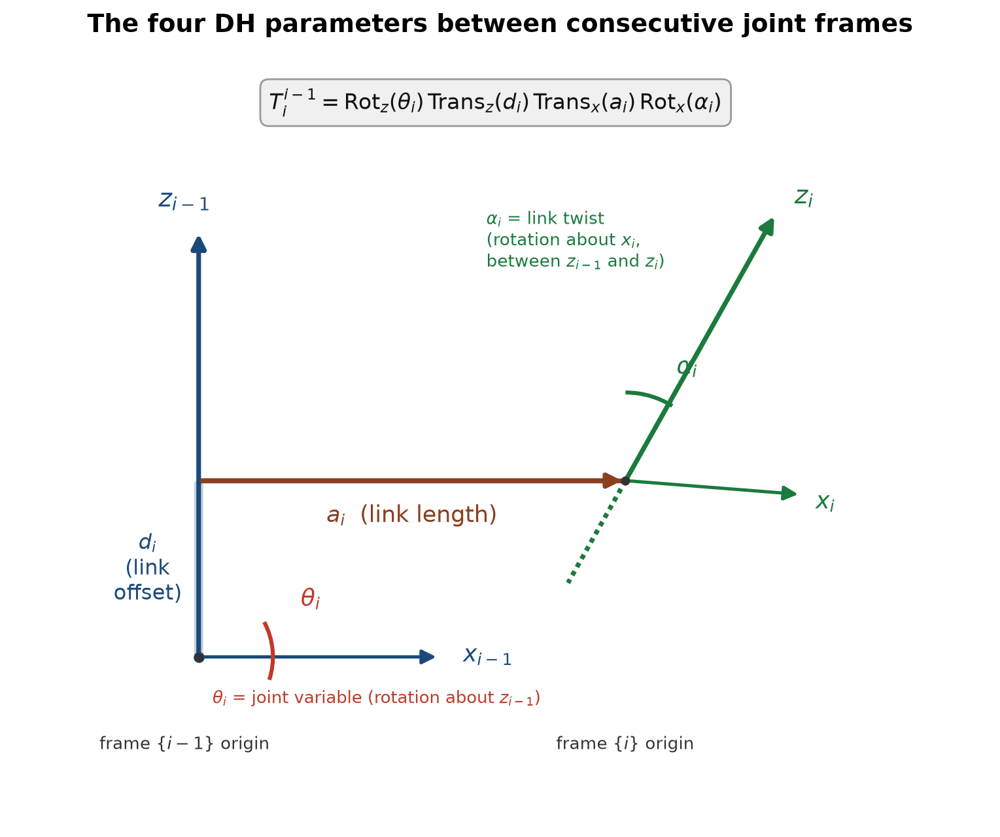

# Robot Arm Load Analyzer — Full Implementation Roadmap

**3D, full Denavit–Hartenberg kinematics, dynamic load analysis, realistic rendering**

A direct, honest note before anything else: what you're describing now — full 3D, proper DH kinematics, *dynamic* (not just static) load analysis, and realistic rigged rendering — is a genuine multi-week robotics project. It's the kind of scope a graduate robotics course spends a whole semester on. That's not a reason not to do it; it's a reason to **phase it properly**, so the midterm has a real, working, honestly-scoped deliverable, and the rest of the vision has a clear path instead of being crammed into days and coming out broken. This document is that phased plan.

---

## Roadmap Overview



| Phase | Timeframe | Delivers |
|---|---|---|
| **1** | Week 1 (midterm) | Real 3D kinematics via full DH parameters, static load analysis, working 3D view with visible joints |
| **2** | Weeks 2–3 | Full dynamic analysis (moving arms, not just held poses) |
| **3** | Weeks 4–5 | Realistic rendering — the arm/hand actually *looks* real, not primitive shapes |
| **4** | Week 6+ | Stretch: multi-finger hands, trajectory playback, saved configs |

Each phase below includes what it is, the math behind it, and what changes in the code.

---

## Phase 1 — DH Kinematics + Static Load Analysis (Week 1, Midterm)

### Why DH parameters, not simple trig

The earlier plan computed joint positions with basic 2D trigonometry — fine for a flat arm, but it doesn't generalize to a real 3D arm where joints can twist on different axes (a shoulder that rotates sideways *and* an elbow that hinges up-down, for instance). **Denavit–Hartenberg (DH) parameters** are the standard, general way to describe *any* serial-link robot's geometry, 3D included, using just four numbers per joint.



For joint *i*, the four parameters are:

| Parameter | Meaning |
|---|---|
| `a_i` | **link length** — distance between joint axes `z_{i-1}` and `z_i`, along their common perpendicular |
| `alpha_i` | **link twist** — angle between `z_{i-1}` and `z_i`, about that common perpendicular |
| `d_i` | **link offset** — distance along `z_{i-1}` to where the common perpendicular meets it |
| `theta_i` | **joint angle** — the one you actually *control*; rotation about `z_{i-1}` |

Each joint's transform relative to the previous one is a single 4×4 matrix:

```
T_i^(i-1) = Rot_z(theta_i) * Trans_z(d_i) * Trans_x(a_i) * Rot_x(alpha_i)
```

Chain them together and you get the full pose (position *and* orientation, in 3D) of every joint and the end-effector, for *any* arm geometry — not just planar ones:

```
T_n^0 = T_1^0 * T_2^1 * T_3^2 * ... * T_n^(n-1)
```

**This is the real generality upgrade.** An arm is now fully described by a table of `(a, alpha, d)` triples (one row per joint) plus joint limits — drop in any serial arm's DH table and the whole kinematics chain works unmodified.

> **Convention warning, genuinely worth flagging:** there are two common DH conventions — "standard/classic" (used above) and "modified" (Craig's textbook). They order the matrix multiplications differently and are a classic source of silent, hard-to-debug sign/axis errors. Pick one, write down which one in your README, and don't mix references that use the other.

### Static load analysis, reframed correctly for 3D

The earlier "sum of moments" shortcut only works cleanly in 2D. The correct, general approach — and the one that sets up Phase 2 cleanly — is the **Jacobian transpose method**:

```
tau = J^T * F_ext
```

where `J` is the manipulator Jacobian (built directly from the DH transforms — it relates joint velocities to end-effector velocity) and `F_ext` is the external wrench (force + torque) applied at the end-effector — here, the payload's weight. This is the textbook-correct way to map an end-effector load to joint torques for *any* 3D arm, and it's a natural stepping stone to full dynamics: **static analysis is just the dynamic equations (Phase 2) with zero velocity and zero acceleration.** Same algorithm, simpler special case — that framing is exactly how real robotics code is usually structured, so you're not throwing away Phase 1 work when you get to Phase 2.

### What ships at the end of Phase 1

- DH-table-driven 3D forward kinematics (any serial arm, not just planar)
- Static joint torques via Jacobian transpose (gravity + payload)
- A working 3D view — basic geometry (cylinders for links, spheres for joints) is enough here; the "looks like a real hand" visual polish is Phase 3, deliberately deferred so Phase 1 stays achievable in a week
- The AI surrogate, trained on this static case (same idea as before: sweep random poses/payloads through the exact DH+Jacobian calculation, train a small model on the result)

---

## Phase 2 — Full Dynamic Analysis (Weeks 2–3)

Static analysis answers "what torque holds this pose." Dynamic analysis answers the harder, more useful question: "what torque does this joint need *right now*, given the arm is also moving" — accounting for velocity, acceleration, and how every link's inertia reacts to that motion. This is what a real robot's controller actually needs, and it's what makes the tool able to analyze an arm *swinging* under load, not just posed and frozen.

### The Recursive Newton-Euler Algorithm (RNEA)

This is the standard algorithm (every robotics textbook — Craig, Spong, Siciliano — has a chapter on it). Two passes over the chain, per timestep:

**Forward pass (base → tip)** — propagate motion outward, link by link:
```
omega_i     = R * omega_(i-1)  +  theta_dot_i * z_i              (angular velocity)
omega_dot_i = R * omega_dot_(i-1) + R*omega_(i-1) x (theta_dot_i*z_i) + theta_ddot_i*z_i   (angular accel.)
a_i         = (rigid-body acceleration of link i's center of mass,
               computed from omega_i, omega_dot_i, and the previous link's acceleration)
```

**Backward pass (tip → base)** — propagate force/torque inward, link by link:
```
F_i   = m_i * a_i                                    (Newton: force needed to accelerate this link)
N_i   = I_i * omega_dot_i  +  omega_i x (I_i * omega_i)   (Euler: torque needed, including gyroscopic/Coriolis effects)
tau_i = (project the accumulated joint force/torque onto this joint's axis z_i)
```

Setting every velocity and acceleration to zero collapses this exactly to Phase 1's static case — which is why Phase 1 isn't wasted work.

### What this requires that Phase 1 didn't

- **A 3×3 inertia tensor per link** (not just a point mass) — how a link resists *rotational* acceleration, which depends on its shape/mass distribution, not just its weight
- **Joint velocities and accelerations as inputs** — either set directly ("what if this joint is spinning at X rad/s"), or computed from a user-defined trajectory (a sequence of poses over time)
- Noticeably more careful bookkeeping — this pass genuinely has more moving parts than Phase 1, which is exactly why it's its own multi-week phase rather than a bullet point

### What ships at the end of Phase 2

- Full RNEA: the arm can be analyzed *while moving*, not just held still
- The AI surrogate extended to the higher-dimensional dynamic input (pose + velocity + acceleration + payload → torque) — a meaningfully harder regression problem than Phase 1's, likely needs a larger network and more training data
- UI: ability to specify a velocity/acceleration (or scrub through a simple trajectory) and watch the torque numbers respond in real time, not just change with static pose

---

## Phase 3 — Realistic 3D Rendering (Weeks 4–5)

This is the "looks like a real hand" part, and it's worth separating cleanly from the physics/AI work above — it's a genuinely different skill set (3D art/rigging pipeline), and bolting it onto Phase 1 would have blown the midterm deadline for no good reason, since the physics and AI parts don't care what the arm looks like.

### Two realistic paths, in order of effort

**Path A — procedural but polished (do this first).** Keep the link/joint geometry procedural (cylinders, capsules, spheres — generated from code, same as Phase 1), but invest in **Qt Quick 3D's PBR (physically-based rendering) materials and lighting**: brushed-metal or matte-plastic material on the links, proper ambient + directional lighting, subtle shadows. This alone gets you most of the way to "looks like a real mechanical arm" without touching 3D modeling software at all — materials and lighting do more visual work than people expect.

**Path B — an actual rigged mesh (if you want the literal hand/gripper look).** Source or build a rigged 3D model (a robotic gripper or an articulated hand — e.g. a free, appropriately-licensed rigged model, or a simple one built in Blender), import it as glTF into Qt Quick 3D, and **drive its bone rotations from your computed joint angles every frame** instead of your own procedural geometry. This is a real, well-established technique (it's how every 3D game animates characters), but it adds genuine pipeline work:

- Matching the model's bone hierarchy to your DH joint chain (they need to correspond 1:1, or you need a mapping between them)
- Aligning coordinate systems — your DH frames and the model's bone-local frames are very unlikely to agree out of the box, and a sign/axis mismatch here is the single most common bug in this kind of work
- Keeping the rig's rest pose and your "all joint angles = 0" pose consistent, so `theta_i` actually means the same thing to the physics and to the mesh

**Recommendation: do Path A thoroughly first.** It's lower-risk, ships faster, and the earlier UI mockup already assumed this level of polish. Treat Path B as what you reach for only if Path A is done early and you have real time left — it's genuinely a "nice to have that's also a time sink," not a core requirement to prove the project works.

### What ships at the end of Phase 3

- A 3D arm that looks intentional and real — proper materials, lighting, and (if Path B) an actual rigged mesh — not placeholder primitives
- Smooth real-time animation as poses/loads change, color-coding carried over from Phase 1

---

## Phase 4 — Stretch Goals (Week 6+)

Not required for the core project to be complete and impressive — listed so there's an obvious "here's what's next," which is also exactly what makes the project something *others* could pick up and extend:

- **Multi-finger / tree-structured kinematics** — if "real hand" specifically means a multi-fingered gripper rather than a single arm, this is where it belongs: each finger is its own DH chain, all sharing one base/palm frame. A genuinely different (harder) topology than a single serial chain, so it's correctly scoped as its own phase, not folded into Phase 1 or 3.
- **Trajectory playback** — record/scrub through a sequence of poses over time, watching dynamic torque change live (this is the single best demo of why Phase 2's dynamics work mattered).
- **Save/load arm configurations directly from the UI**, instead of hand-editing a config file.

---

## What Changes in "What You'll Need"

Everything from the original plan still applies (Qt 6, C++17 + CMake, Eigen, Python+PyTorch for training). Added for this expanded scope:

| Need | For |
|---|---|
| **Qt Quick 3D** | 3D rendering (Phases 1 and 3) |
| A DH-table data structure/format (e.g., a simple JSON schema: array of `{a, alpha, d, joint_type}`) | Making the arm genuinely swappable, per the original generality goal |
| Inertia tensor data per link | Phase 2 dynamics |
| *(Phase 3, Path B only)* a glTF-compatible 3D modeling tool (e.g., Blender, free) and/or a sourced rigged model | Realistic mesh rendering |

---

## The One-Sentence Version

**Week 1** proves the hard engineering is correct (real 3D kinematics, real static physics) and ships something real for the midterm. **Weeks 2–3** make it genuinely dynamic. **Weeks 4–5** make it look like it's worth showing someone. **Week 6+** is bonus.
